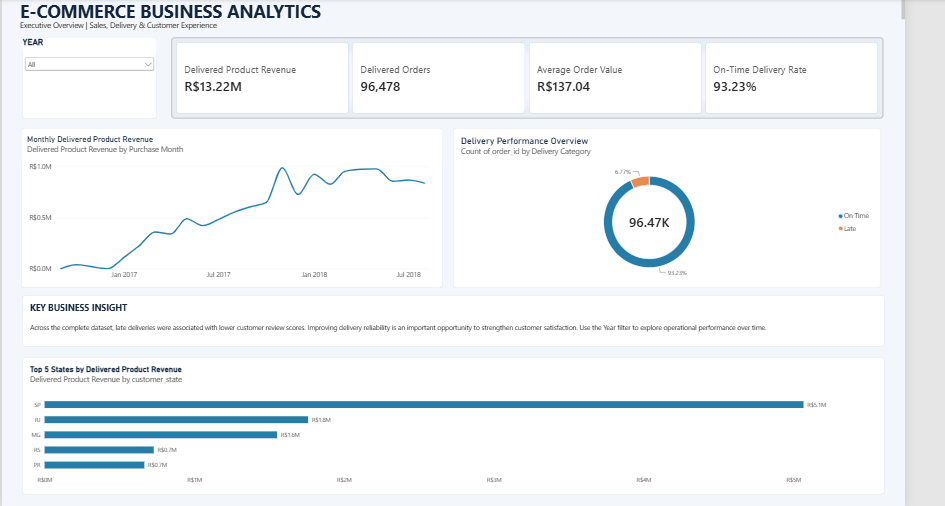
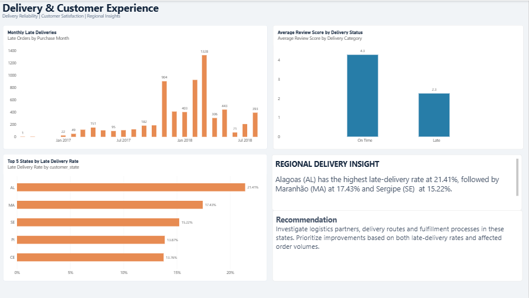
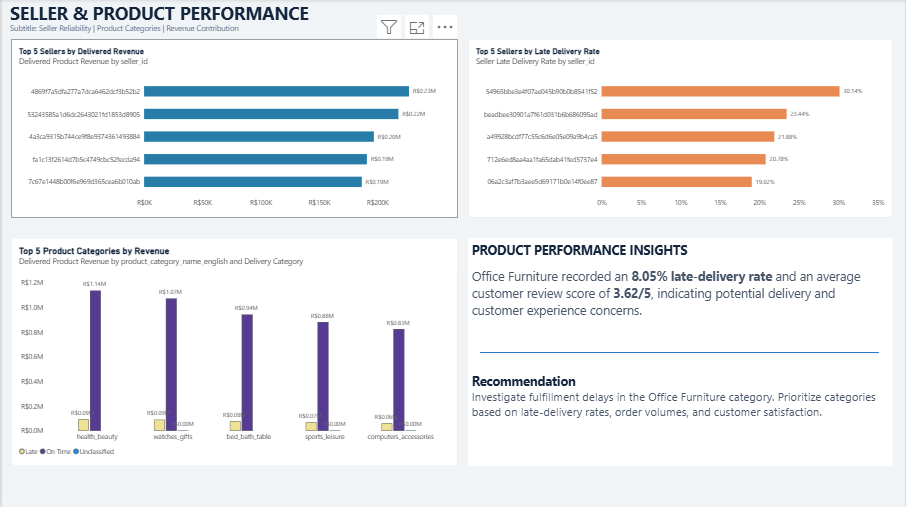

# E-Commerce Business Analytics | SQL & Power BI

## Project Overview

This project analyzes the Brazilian E-Commerce Public Dataset by Olist to evaluate revenue performance, delivery efficiency, customer satisfaction, seller performance, and product category trends.

Using MySQL for data validation and business analysis, and Power BI for interactive reporting, I developed three dashboards to translate transactional data into actionable business insights.

The analysis focuses on identifying revenue drivers, understanding the impact of late deliveries on customer experience, and highlighting opportunities to improve seller and logistics performance.

## Business Objectives

The objective of this project is to analyze e-commerce business performance and identify actionable opportunities for improving revenue, logistics, and customer satisfaction.

The analysis addresses five key business questions:

1. **Revenue Performance:** How does delivered product revenue change over time, and which states and product categories contribute the most?
2. **Delivery Efficiency:** What percentage of orders arrive on time, and which months and regions experience the most delivery delays?
3. **Customer Experience:** How are late deliveries associated with customer review scores and dissatisfaction?
4. **Seller Performance:** Which sellers generate the most revenue, and which have the highest late-delivery rates after accounting for order volume?
5. **Product Performance:** Which product categories perform strongly in revenue, and which show potential delivery or customer satisfaction issues?

The findings are intended to support data-driven decisions in logistics optimization, seller performance monitoring, and customer experience improvement.

## Dataset & Tools

### Dataset

**Source:** Brazilian E-Commerce Public Dataset by Olist (Kaggle)

The dataset contains transactional information from a Brazilian e-commerce marketplace, including customer orders, payments, product details, seller information, delivery timestamps, customer reviews, and geographic data.

The original dataset consists of nine CSV files, which were imported into MySQL for data validation and analysis.

### Tools & Technologies

- **MySQL 8.0 & MySQL Workbench:** Data validation, SQL joins, aggregations, KPI calculations, and advanced business analysis.
- **Power BI Desktop:** Data modeling, relationships, DAX measures, interactive dashboards, and business reporting.
- **DAX:** Calculated measures and columns for revenue, order volume, delivery performance, and seller analysis.
- **Power Query:** Data preparation and data type configuration.
- **VS Code:** SQL script organization and project documentation.

### Data Model

The analysis combines data from orders, order items, customers, sellers, products, product category translations, and customer reviews to evaluate business performance across multiple dimensions.

## Key Performance Indicators (KPIs)

The following KPIs were calculated using SQL and validated against the Power BI dashboards.

| KPI | Result |
|---|---|
| Delivered Product Revenue | R$13,221,498.11 |
| Delivered Orders | 96,478 |
| Average Order Value (AOV) | R$137.04 |
| On-Time Delivery Rate | 93.23% |
| On-Time Deliveries | 89,936 |
| Late Deliveries | 6,534 |
| Average Review Score — On-Time Deliveries | 4.29 / 5 |
| Average Review Score — Late Deliveries | 2.27 / 5 |
| Highest Monthly Late-Delivery Count | March 2018 — 1,328 |
| August 2018 Delivered Product Revenue | R$838,576.64 |

### KPI Definitions

- **Delivered Product Revenue:** Total product sales value from delivered orders, excluding freight charges.
- **Delivered Orders:** Number of distinct orders with a delivered status.
- **Average Order Value:** Delivered product revenue divided by the number of distinct delivered orders.
- **On-Time Delivery Rate:** Percentage of eligible delivered orders received on or before their estimated delivery date.
- **Late Deliveries:** Delivered orders received after their estimated delivery date.
- **Average Review Score:** Mean customer review rating for orders classified by delivery performance.

These KPIs provide a consolidated view of revenue, delivery reliability, and customer satisfaction.

## Key Business Findings & Recommendations

### 1. Delivery Delays and Customer Satisfaction

**Finding:** Orders delivered on time received an average review score of 4.29/5, compared with 2.27/5 for late deliveries.

**Recommendation:** Prioritize delivery reliability by monitoring late-delivery rates, investigating recurring logistics delays, and introducing early-warning indicators for orders at risk of missing their estimated delivery dates.

### 2. Regional Delivery Performance

**Finding:** States including AL, MA, SE, PI, and CE showed some of the highest late-delivery rates.

**Recommendation:** Investigate regional logistics challenges and identify whether delivery delays are associated with transportation distances, seller locations, carrier performance, or fulfillment processes.

### 3. Seller Performance

**Finding:** The highest late-delivery rate among sellers with at least 50 eligible delivered orders was 30.14%.

**Recommendation:** Establish seller performance scorecards tracking order volume, revenue, and late-delivery rates. Prioritize consistently underperforming sellers for operational review.

### 4. Product Category Performance

**Finding:** Health & Beauty was a leading revenue-generating product category, while Office Furniture showed relatively weak delivery and customer review performance.

**Recommendation:** Protect high-performing product categories while investigating fulfillment, packaging, and shipping challenges in categories with weaker customer experience metrics.

### 5. Monthly Delivery Trends

**Finding:** March 2018 recorded the highest monthly late-delivery count, with 1,328 late deliveries.

**Recommendation:** Monitor monthly late-delivery rates alongside absolute late-delivery counts to distinguish increases caused by higher order volumes from deterioration in delivery reliability.

### Overall Business Conclusion

The analysis highlights delivery reliability as an important area for operational improvement. Late deliveries are associated with substantially lower customer review scores, while regional, seller-level, and product-category differences reveal opportunities for targeted investigation.

By combining revenue metrics with delivery and customer experience indicators, the project provides a foundation for data-driven business monitoring and operational decision-making.

## Power BI Dashboards

Three interactive Power BI dashboard pages were developed to visualize key business metrics and support data-driven decision-making.

### Dashboard 1: Executive Overview

Provides a high-level summary of overall e-commerce performance.

**Key Features:**
- Delivered Product Revenue: R$13.22M
- Delivered Orders: 96,478
- Average Order Value: R$137.04
- On-Time Delivery Rate: 93.23%
- Monthly Delivered Product Revenue trend
- On-Time vs. Late Deliveries distribution
- Top 5 States by Revenue
- Year slicer and business insight panel

### Dashboard 2: Delivery & Customer Experience

Focuses on delivery reliability and its association with customer satisfaction.

**Key Features:**
- Monthly Late Deliveries trend
- Average Review Score by Delivery Status
- Top 5 States by Late Delivery Rate
- Business insight panel highlighting delivery performance challenges

**Key Insight:** Late deliveries received a substantially lower average review score (2.27) than on-time deliveries (4.29).

### Dashboard 3: Seller & Product Performance

Evaluates seller-level performance and product category contributions.

**Key Features:**
- Top 5 Sellers by Delivered Revenue
- Top 5 Sellers by Late Delivery Rate (minimum 50 eligible delivered orders)
- Top 5 Product Categories by Revenue
- Business insight panel highlighting seller and category opportunities

**Key Insight:** The highest late-delivery rate among eligible sellers was 30.14%, highlighting the importance of monitoring seller performance while accounting for order volume.

### Dashboard Screenshots

Screenshots of all three dashboard pages are available in the `dashboard_screenshots` folder.

### Executive Overview

### Delivery & Customer Experience

### Seller & Product Performance

